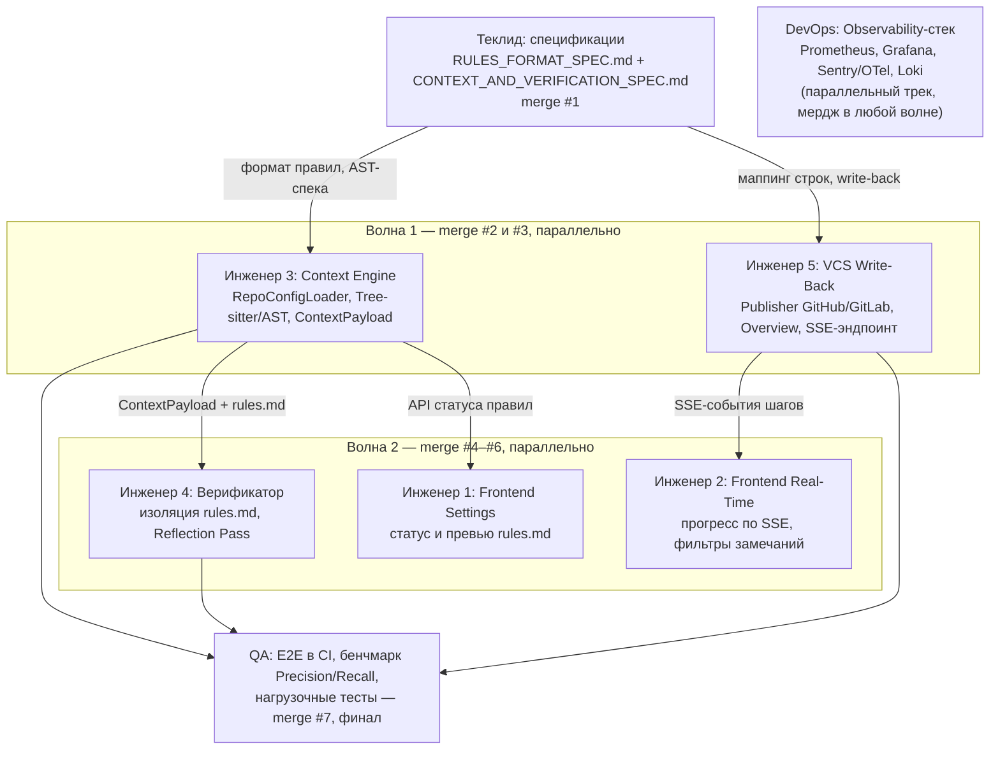
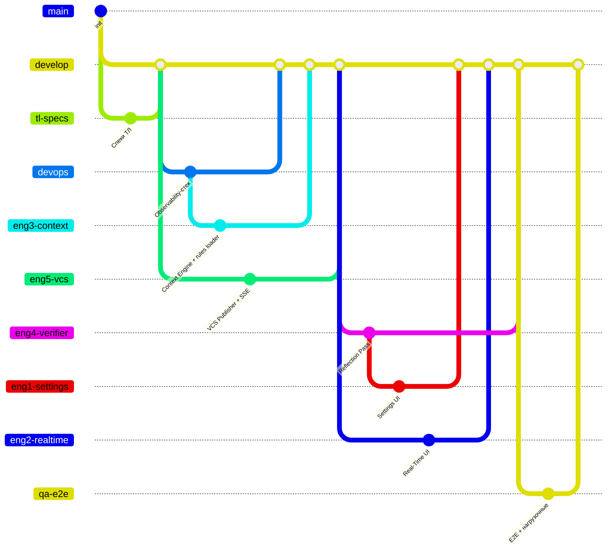

# Спринт 3: порядок выполнения задач и мерджей в `develop`

Порядок выведен из зависимостей задач в [`Спринт.md`](../Спринт.md):

- **Спеки Теклида** — фундамент: формат `.review/rules.md`, AST-контекст, маппинг строк и write-back → первый мердж.
- **DevOps** — не зависит ни от кого, идёт параллельным треком в любой волне.
- **Волна 1** — Инженер 3 (нужен формат правил и контекст-спека) и Инженер 5 (нужен маппинг строк и write-back).
- **Волна 2** — Инженер 4 (нужен `ContextPayload` от Инж 3), Инженер 1 (нужен API статуса правил от Инж 3), Инженер 2 (нужен SSE-эндпоинт от Инж 5).
- **QA** — последним: E2E требует полного конвейера (3 → 4 → 5).

## Граф зависимостей

## Порядок мерджей в `develop`

## Сводная таблица

| # | Задача | Роль | Зависит от |
|---|---|---|---|
| 1 | Спецификации формата правил, AST-контекста, write-back | Теклид | — |
| 2–3 | Context Engine (RepoConfigLoader, AST, ContextPayload) | Инженер 3 | #1 |
| 2–3 | VCS Publisher + SSE-эндпоинт | Инженер 5 | #1 |
| — | Observability-стек, бэкапы | DevOps | — (параллельно) |
| 4–6 | Верификатор, анти-инъекция, Reflection Pass | Инженер 4 | #1, Инж 3 |
| 4–6 | Frontend Settings, статус и превью rules.md | Инженер 1 | #1, Инж 3 |
| 4–6 | Frontend Real-Time: SSE-статус, фильтры | Инженер 2 | #1, Инж 5 |
| 7 | E2E в CI, бенчмарки, нагрузочные тесты | QA | Инж 3, Инж 4, Инж 5 |
