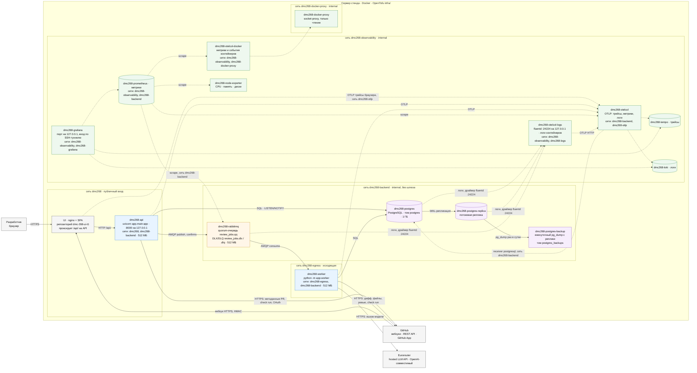
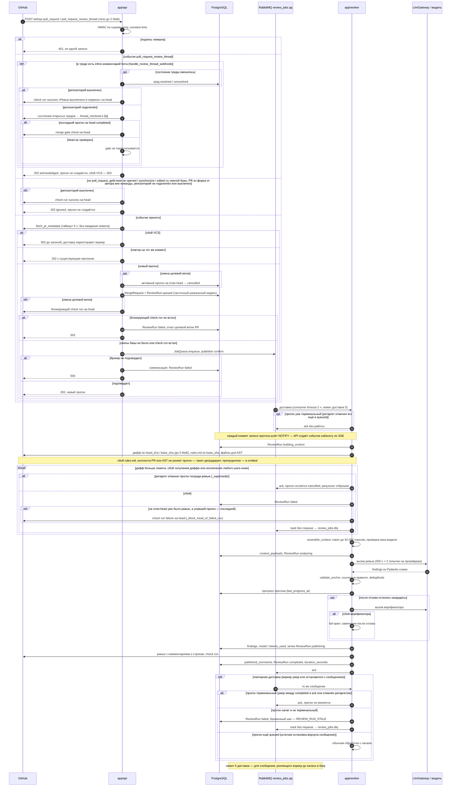

# Git ИИ Ревьюер кода — системный дизайн

Система автоматического ревью кода: отслеживает изменения в pull request'ах, собирает контекст вокруг диффа, передаёт его на ревью LLM и публикует результат обратно в VCS.

> **Разделение ответственности документов.** Этот документ владеет топологией развертывания, layout'ом обменов и очередей RabbitMQ, фронтендом, платежным UX и выбором внешних провайдеров (LLM provider / LLM API). Источник истины по слоям, портам, схеме данных, миграциям и threat model — [BACKEND_ARCHITECTURE.md](BACKEND_ARCHITECTURE.md); по модели данных — [erd.md](erd.md). При расхождении приоритет у BACKEND_ARCHITECTURE.md.

## 1. Диаграмма компонентов

```mermaid
flowchart TB
    %% External
    GH[GitHub<br/>PR / Push Events]
    GHR[GitHub<br/>Review Comments / Status]
    PP[Payment Provider<br/>Stripe / etc.]
    OLLAMA[Ollama · local model<br/>in our network · primary]
    EURO[Eurorouter · hosted LLM API<br/>opt-in fallback only]
    FE[Frontend<br/>PR History · Settings · Usage/Billing · Admin]

    %% Infrastructure
    MQ[RabbitMQ<br/>Message Broker / Queues]
    DB[(PostgreSQL<br/>only PostgreSQL: native enums · JSONB<br/>partial unique index)]

    %% Modular monolith
    subgraph MONOLITH["Modular monolith: one codebase, one image, two processes"]
        API["app/api · uvicorn app.main:app<br/>webhook intake · HMAC verify · validation<br/>rate limiting · idempotency · REST for the frontend"]
        WORKER["app/worker · python -m app.worker<br/>review consumer · stale-run sweep"]
        ORCH["Application use cases<br/>context assembly · prompt assembly (pure functions)<br/>review call · screening · verifier call<br/>next_status"]
        PARSE["DefinitionExtractor port · tree-sitter adapter<br/>outline of changed files for the ast tier<br/>used by orchestrator code, never by the model"]
        CACHE["CacheStore port · in-process TTL dict<br/>repo rules by (repo, base_sha)"]
        VCS["VcsGateway port · GitHub REST adapter<br/>diffs · metadata · file contents · comments · statuses<br/>GitHub App auth · backoff inside the adapter"]
        LGW["LlmGateway port · fallback adapter<br/>Ollama first · Eurorouter only by flag<br/>answer checked against the response model"]
        REPOS["Repository ports + UnitOfWork<br/>SQLAlchemy adapters"]
    end

    %% Planned seams
    subgraph PLANNED["Planned seams (designed, not built)"]
        PAY["Payments / accounts<br/>plans · subscriptions · billing"]
    end

    %% Event flow
    GH -->|Webhook, HMAC-signed| API
    FE <-->|REST| API
    API -->|JobQueue enqueue| MQ
    MQ --> WORKER
    WORKER --> ORCH
    API -->|settings · history · usage| ORCH

    %% VCS
    ORCH <-->|PR data / diffs / files| VCS
    ORCH --> PARSE
    ORCH <--> CACHE
    VCS -->|review comments / status| GHR

    %% LLM
    ORCH <--> LGW
    LGW <-->|primary| OLLAMA
    LGW -.->|opt-in fallback| EURO

    %% Data and telemetry
    ORCH -->|runs · findings · context · comments · telemetry| REPOS
    REPOS --> DB

    %% Planned seams
    API -.-> PAY
    PAY -.->|subscription / payment| PP

    %% Styling
    classDef external fill:#f5f5f5,stroke:#555,color:#111;
    classDef core fill:#e8f4ff,stroke:#2878c8,color:#111;
    classDef planned fill:#eef8ef,stroke:#368a4a,color:#111;
    classDef infra fill:#fff6e8,stroke:#c88719,color:#111;
    classDef db fill:#f7eefc,stroke:#8a4db8,color:#111;

    class GH,GHR,PP,OLLAMA,EURO,FE external;
    class API,WORKER,ORCH,VCS,LGW,REPOS,PARSE,CACHE core;
    class PAY planned;
    class MQ infra;
    class DB db;
```



Сплошные узлы и связи — построено. Пунктир — запланированные швы (таблица «Designed, not built» в BACKEND_ARCHITECTURE.md): порт не пишется раньше первого вызова, шов описывается заранее и бесплатно.

### 1.1 Диаграмма контейнеров (C4, уровень Container)

Что выкатывает деплой на стенд: один хост, Docker, ресурсы `docker_container` из `infra/*.tf`. Узел — контейнер (имя на хосте), подпись связи — протокол. Подграфы — сети Docker (`infra/network.tf`, `infra/observability.tf`); контейнер в нескольких сетях нарисован в той, где его основная роль, остальные сети перечислены в узле.



- **Модель на стенде** — Eurorouter основным и единственным провайдером (`TF_VAR_llm_backend: eurorouter` в `.github/workflows/deploy.yml`, #245). Ollama на стенде не развёрнута, поэтому на диаграмме её нет; на диаграмме компонентов выше она — основной провайдер по дизайну.
- **UI** — контейнер стека `dmc-268-ui-t1`, подключается к сети `dmc268` по имени; в этом репозитории не описан и показан как внешний.
- **Изоляция**: у `dmc268-backend` и `dmc268-observability` нет шлюза — база, брокер и хранилища наблюдаемости не видны ни из интернета, ни из публичной сети. Наружу ходят API (через `dmc268`) и воркер (через `dmc268-egress`); не-internal сети со шлюзом есть ещё у Grafana (`dmc268-grafana`) и `dmc268-otelcol-logs` (`dmc268-logs`) — ради публикации порта на 127.0.0.1: на internal-сети Docker порты не публикует. Стек наблюдаемости поднимается флагом `observability_enabled`, на стенде он включён.
- **Служебные сети** без своих подграфов, перечислены в узлах: `dmc268-otlp` (internal, `infra/network.tf`) — приём OTLP трейсов браузера от UI коллектором; `dmc268-grafana` и `dmc268-logs` (`infra/observability.tf`) — только публикация портов Grafana и fluentd на 127.0.0.1. Сеть `dmc268-docker-proxy` (internal) нарисована отдельно: в ней только socket-proxy и `dmc268-otelcol-docker`, остальным контейнерам доступ к демону Docker не нужен.
- **Логи контейнеров**: `dmc268-postgres`, `dmc268-postgres-replica` и `dmc268-rabbitmq` при включённом стеке пишут логи драйвером fluentd (`local.fluentd_log_opts`, `infra/locals.tf`) — dockerd отправляет их на `127.0.0.1:24224`, в `dmc268-otelcol-logs`, оттуда по OTLP в основной коллектор `dmc268-otelcol` (`otlp_http/collector`, `infra/observability/otelcol-logs.yaml`) и только из него в Loki. У остальных контейнеров, включая бэкап, — драйвер по умолчанию (`local.log_opts`); API и воркер шлют логи по OTLP.
- **Миграции** — не контейнер стека: одноразовый `docker run --rm` того же образа в сети `dmc268-backend` до `apply` (`infra/README.md`, «Миграции»).

## 2. Общая архитектура (компоненты и границы ответственности)

Система — **событийно-ориентированный модульный монолит**: один кодбейс, один образ, два процесса, которые общаются через очередь, а не по HTTP. Это осознанно не микросервисы: микросервисы решают организационную проблему независимых команд, которой здесь нет, а их цену — сетевые вызовы вместо вызовов функций, частичные отказы, версионирование контрактов, идемпотентность на каждой границе — платить нечем. Полное обоснование — раздел «Process shape» в BACKEND_ARCHITECTURE.md.

Границы компонентов ниже — логические (слои `app/api`, `app/application`, `app/domain`, `app/infrastructure`; направление импортов проверяет import-linter в CI), а не деплойментные.

### 2.1 Границы ответственности

- **Frontend (FE)**: настройки репозиториев, история PR, администрирование, usage/billing. Общается с системой только через REST API монолита (`app/api`).
- **`app/api` — HTTP-точка входа (`uvicorn app.main:app`)**: построено — приём вебхуков GitHub с проверкой HMAC-подписи (constant-time, `app/domain/hmac.py`) и постановка задач в очередь через порт `JobQueue`, общий поток событий кабинета по SSE (`GET /api/v1/events`: прогоны пишет воркер, при коммите записи PostgreSQL шлёт `NOTIFY`, API слушает `LISTEN` одним соединением на процесс и дочитывает изменённые прогоны — отдельного брокера событий нет); запланированные швы — rate limiting (fixed-window, порт `RateLimiter`), идемпотентность повторных доставок (порт `IdempotencyStore`), приём вебхуков GitLab, REST для фронтенда.
- **RabbitMQ**: брокер сообщений; адаптер порта `JobQueue` с единственным методом `enqueue` построен (`RabbitMQJobQueue`: тело — только доменные данные, переиспользуемое соединение с publisher confirms, DLX/DLQ для отклонённых сообщений). Layout обменов — зона ответственности этого документа (см. 4.2).
- **`app/worker` — консьюмер ревью (`python -m app.worker`)**: ходит минутами, ограничен латентностью модели; также выметает зависшие прогоны (`find_stale`, `last_progress_at`).
- **Оркестрация - use cases слоя `application`**: сценарий ревью - сборка контекста и запроса (чистые функции), вызов ревью через `LlmGateway`, детерминированный отсев (`validate_anchor`, ссылка на правило, `deduplicate`), вызов верификатора, который может только отбросить замечание, публикация через `VcsGateway`; жизненный цикл прогона - `next_status`. Ретраи с exponential backoff живут в адаптерах. **Модель не получает инструментов и никогда не выбирает действий** - структурная защита от prompt injection (threat model в BACKEND_ARCHITECTURE.md).
- **`VcsGateway` (порт; первый адаптер — GitHub REST)**: диффы (unified diff; сегодня hunk несёт 3 строки контекста, которые отдаёт GitHub, ±30 строк — запланированный уровень `surrounding`), метаданные, комментарии, статусы; аутентификация GitHub App с краткосрочными installation-токенами; содержимое файла на коммите — метод порта `fetch_file` (файлы диффа для уровня `ast` — по `head_sha`, `.review/rules.md` — по `base_sha`; лимиты применяет вызывающий). Payload'ы, синтаксис комментариев, auth и backoff — детали адаптера.
- **`LlmGateway` (порт)**: транспорт к модели. Провайдеры - локальная модель в Ollama (основная) и Eurorouter по OpenAI-совместимому протоколу (фоллбэком при `LLM_HOSTED_FALLBACK=true` или основным и единственным при `LLM_BACKEND=eurorouter` — так работает стенд, #245); порядок не выбирается, а собирается composition root из конфигурации, заглушка - только явным `LLM_BACKEND=stub`. Ответ проверяется Pydantic-моделью из запроса с повторами, ключи Eurorouter ротируются. Сборка промпта и проверка окна модели - чистые функции; адаптер только транспортирует. Включение hosted-фоллбэка - решение по безопасности (крупнейший путь эксфильтрации), не только операционное; детали - в BACKEND_ARCHITECTURE.md.
- **Данные и телеметрия**: не отдельный сервис. Стоимость прогона — колонки `model`, `tokens_used`, `duration_seconds`, `failure_reason` в `review_runs`; per-call аудит (вызовы LLM и инструментов) — будущий шов, его первый заказчик — биллинг по токенам.
- **Payments / accounts**: сегодня спроектирована только таблица `accounts` — она придёт вместе со своим портом (регистрация репозитория с проверкой прав на него); тарифы, подписки, Stripe — запланированный шов. Приоритет платных тарифов — требование к обслуживанию очереди (раздел 4.2), код порта оно не затрагивает.
- **Контекст без клона (принцип)**: репозиторий никогда не клонируется целиком и не хранится — Repository Indexer, Vector DB и Repository Storage исключены из дизайна. Весь контекст строится из данных PR через `VcsGateway`: дифф, AST-окружение изменённых строк (уровень `ast`) и правила владельца из целевой ветки; запланированы ±30 строк вокруг изменений, полные тексты изменённых файлов и сигнатуры из файлов, на которые ссылаются импорты. Анализ кода (tree-sitter за портом `DefinitionExtractor`) идёт над файлами, полученными через `VcsGateway`, и используется кодом оркестратора, а не моделью.

## 3. Потоки данных

1. **Инициация**: вебхук GitHub (`pull_request` с действием `opened`, `synchronize` или `edited` со сменой целевой ветки — check run висит на head-коммите и о базе не знает, #222) приходит в `app/api`, проверяет HMAC-подпись, достаёт через `VcsGateway` только метаданные PR (`fetch_pr_metadata`, из них берётся `base_sha`; сбой VCS — 502 до записей), создаёт `MergeRequest` + `ReviewRun` (state `queued`) и ставит задачу в очередь с парой `head_sha` / `base_sha` — без диффа: его с лимитом размера по этой паре достаёт воркер, он же разбирает дифф и отсеивает шум (capability `webhook-intake` в спеках). Источник прогона фиксируется колонкой `review_runs.trigger_source` (enum `TriggerSource`: `webhook` / `manual` / `mention`); сегодня работает `webhook`, а запуск по назначению бота ревьюером или упоминанию в комментарии (`manual` / `mention`) — запланированный шов. Событие `reopened` и прочие действия игнорируются (202): бот никогда не переназначается автоматически. Ревьюятся только свои PR: из ветки самого репозитория (запушить её может только тот, у кого есть право записи) или из форка от автора `OWNER` / `MEMBER` / `COLLABORATOR` (`author_association`, `is_trusted_author`). Остальные PR из форка игнорируются с записью в лог — временная защита ключа модели до биллинга. Репозиторий, не подключённый в сервисе, игнорируется; у выключенного (`DELETE /api/v1/repositories/{id}`) прогона нет, а на коммит ставится проверка `success` «Ревью выключено в сервисе».
2. **Подлинность и идемпотентность**: проверяется HMAC-подпись доставки (построено, constant-time по сырому телу до разбора payload'а); повторная доставка того же коммита не создаёт второй активный прогон — частичный уникальный индекс схемы (построено), а после завершённого не-`failed` прогона по вебхуку отвечает им, не создавая нового (построено, #75); упавшие доставки воркер переотправляет через `GET /app/hook/deliveries` и `POST …/attempts` (построено, #149). Порт `IdempotencyStore` — запланированный шов: займёт ключ через `INSERT ... ON CONFLICT DO NOTHING` и переиграет исход первой доставки, когда появится.
3. **Очередь**: задача публикуется в RabbitMQ через `JobQueue.enqueue`.
4. **Консюмер**: `app/worker` вычитывает сообщение (job); устойчивая сущность — `ReviewRun` (переименована из `ReviewJob`, чтобы строка БД не делила имя с сообщением очереди).
5. **Сбор контекста**: use case иерархически собирает контекст (раздел 5) и сохраняет показанное модели в `context_payloads`; редакция секретов до вставки — запланирована (задача #28).
6. **Генерация**: запрос, не помещающийся вместе с резервом ответа в окно модели, не отправляется; вызов ревью через `LlmGateway` - локальная модель, при её сбое и включённом фоллбэке Eurorouter; модель возвращает структурированные findings по Pydantic-модели ответа, а не прозу, ответ не по схеме повторяется.
7. **Валидация**: детерминированный отсев - `validate_anchor` отбрасывает замечания вне диффа, ссылка на правило проверяется по показанным модели правилам, `deduplicate` убирает повторы (отклонения считаются на прогоне); затем второй вызов - верификатор (Reflection Pass) - отбрасывает галлюцинации, а при сбое прогон продолжается с замечаниями после отсева (fail-open); переходы статуса - через `next_status`.
8. **Публикация**: `VcsGateway` публикует Review Comments и статусы; каждый опубликованный комментарий фиксируется в `published_comments`.
9. **Телеметрия**: `model`, `tokens_used`, `duration_seconds`, `failure_reason` пишутся в `review_runs`.

### 3.1 Диаграмма последовательности основного потока

Тот же поток по шагам, с ветками отказа. Таймауты и лимиты на стрелках — из раздела 7.



## 4. Правила взаимодействия с VCS, форматы очередей и кэширование

### 4.1 Взаимодействие с VCS (GitHub API)

- **Аутентификация**: GitHub Apps — краткосрочные installation access токены; утечка ограничена одной инсталляцией, а не всеми репозиториями владельца токена.
- **Rate Limits & Fallbacks**: повторы — внутри адаптера `VcsGateway`, одним циклом: 5xx — exponential backoff; 429 и 403 лимита (у GraphQL — ещё `RATE_LIMITED` при 200) — пауза по `retry-after`, `x-ratelimit-reset` или минута, в пределах бюджета ожидания (воркер — 60 с на запрос, API — 0: отказ уходит 5xx, доставку переотправит воркер). Идемпотентности у создания ревью нет: оно повторяется, только если после паузы ревью бота со скрытым маркером прогона в теле не нашлось. Таймаут клиента GitHub — 5 с в API (вебхук) и 30 с в воркере.
- **Подлинность вебхуков**: GitHub подписывает доставки HMAC по телу; без проверки любой, кто узнал endpoint, может заставить систему ревьюить что угодно и тратить бюджет модели.
- **Вход пользователей**: OAuth того же GitHub App выполняет бэкенд (`/api/v1/auth/{provider}/login` и `/callback`, порт `OAuthProvider`). Токен пользователя хранится зашифрованным: по нему GitHub отдаёт репозитории установок, доступные пользователю; ревью по-прежнему ходит installation-токенами. Как приложение, установка и подключение репозитория связаны — [`GITHUB_APP.md`](GITHUB_APP.md). Сессия — случайное значение в httpOnly cookie на общем origin интерфейса и API, в базе только его хэш, выход действует сразу. Изменяющие запросы с сессией сверяют `Origin`. Детали — `openspec/changes/archive/2026-10-17-auth-session/design.md` и спека `user-auth`.

### 4.2 Формат очереди задач (RabbitMQ) 

JSON-сообщение; тело несёт только доменные данные — метаданные доставки (маршрут, приоритет) живут в свойствах AMQP и в тело не дублируются. Очередь одна — quorum-очередь `review_jobs.qq`, приоритеты (0–31 у quorum-очереди RabbitMQ 4.3+) у неё включены всегда. Требование: прогоны платных тарифов обслуживаются раньше бесплатных; в AMQP оно отображается свойством `priority` (0–9), учитываемым среди сообщений, ожидающих в очереди. Как требование выражается в коде — зона ответственности BACKEND_ARCHITECTURE.md: порт `JobQueue` сведён к одному методу `enqueue(job)`, адаптер RabbitMQ выводит приоритет из самого job'а (тариф аккаунта и так в данных, слой `application` про тарифы не знает), поэтому layout обменов и приоритеты кода не затрагивают. **Пока:** `accounts`/тарифы не реализованы, поэтому каждое сообщение публикуется с одним и тем же фиксированным приоритетом — очередь уже готова к приоритизации, вычисление появится вместе с тарифами, без смены типа очереди.

```json
{
  "job_id": "uuid-1234",
  "review_run_id": "uuid-5678",
  "event_type": "pull_request",
  "action": "opened",
  "installation_id": 512804923,
  "repository": {
    "full_name": "owner/repo",
    "id": "987654"
  },
  "pull_request": {
    "number": 42,
    "head_sha": "abc123def",
    "base_sha": "fed654cba"
  }
}
```

`job_id` — идентификатор сообщения (UUIDv7, генерируется в домене, не базой, новый на каждую постановку); устойчивая строка — `ReviewRun`, воркер находит её по `review_run_id`; дедупликация повторных доставок — `IdempotencyStore`. `installation_id` — инсталляция провайдера для авторизации воркера при повторном получении диффа (разбор диффа — у воркера, тело сообщения дифф не несёт).

**Dead-letter queue.** Очередь `review_jobs.qq` объявлена с
`x-dead-letter-exchange: review_jobs.dlx` — fanout-exchange, на который
забинжена очередь `review_jobs.dlq`. Воркер, обработка которого завершилась
исключением, отвечает `nack` без `requeue`: сообщение не крутится в основной
очереди по кругу, а ровно один раз перекладывается в `review_jobs.dlq` для
ручного разбора. Перед `nack` упавший прогон ставит `failure` на head, если
он на этом head последний, а до него ревью уже было (`_block_head_of_failed_run`):
иначе на PR остался бы `success` прежнего прогона. Исключения — прогон, отменённый ретаргетом посреди ревью
(`_supersede`): сообщение подтверждается `ack`, прогон остаётся `cancelled`; и прогон,
отменённый ретаргетом ещё в `queued`: воркер подтверждает сообщение `ack` при первой
же доставке, ничего не делая. Ретраев с backoff перед dead-letter пока нет — осознанное
упрощение, зафиксированное в `design.md` OpenSpec change'а
`add-rabbitmq-job-queue`.

**Лимит доставок.** Смерть процесса воркера — не исключение: сообщение не
отклонено, а возвращается брокером при обрыве соединения. Quorum-очередь
считает такие возвраты и после `x-delivery-limit: 5` повторных доставок
уводит сообщение в тот же DLX — сообщение, убивающее воркер на каждой
доставке, не крутится вечно. Ревью смерть воркера не повторяет. Что сделает
повторная доставка, решает статус прогона (`run_review`,
`app/application/review_pipeline.py`): терминальный прогон (воркер умер между
коммитом `completed` и `ack` или прогон отменён ретаргетом) подтверждается без изменений; начатый
нетерминальный уходит в `failed` (`REVIEW_RUN_STALE` на брошенном шаге), а
сообщение — в DLQ; ещё `queued` обрабатывается с начала. Запас лимита — для сообщения, роняющего процесс до записи
в базу, и для рестартов при деплое. Штатная остановка возвращает выданное, но не
взятое в работу сообщение `nack` с `requeue`: он попытку не тратит (change
`queue-delivery-limit`, #223). Таймаут подтверждения — 2 ч, аргумент потребителя
`x-consumer-timeout`: сообщение, не подтверждённое за это время, брокер забирает
у воркера, поэтому худший прогон обязан быть короче, и старт воркера это
проверяет (`check_consumer_timeout`). До #223 очередь была классической `review_jobs`:
тип объявленной очереди не меняется, поэтому quorum-очередь — под новым именем, а
старую при выкате удаляют на брокере (`rabbitmqctl delete_queue review_jobs --if-empty`).

### 4.3 Стратегия кэширования

- **CacheStore**: best-effort key/value с TTL; сначала in-process словарь — корректен, пока процесс один, Redis-адаптер появляется вместе со второй репликой. Промах — не ошибка. Семантический кэш LLM-запросов не планируется: ключ точный.
- **Кэш правил (построено)**: результат загрузки `.review/rules.md` — в `InMemoryCacheStore` по ключу `repo-rules:v1:{репозиторий}:{base_sha}`; сбой VCS не кэшируется.
- **Кэш файлов (запланировано, по измерениям)**: диффы и содержимое файлов, полученные через `VcsGateway`, — в CacheStore по неизменяемым ключам (репозиторий, путь, sha); содержимое по sha не меняется, промах — не ошибка.

## 5. Концепция сборщика контекста (Context Assembly)

Сборка контекста и промпта — чистая функция (адаптер `LlmGateway` только транспортирует). Репозиторий не клонируется и не хранится: каждый уровень собирается из данных PR и содержимого файлов по `head_sha` (правила — по `base_sha`), полученных через `VcsGateway`. Уровни записываются в `context_payloads.tiers` (`diff`, `surrounding`, `whole_file`, `ast`); сегодня пишутся `diff` и, при наличии AST-блоков, `ast`. Для соблюдения лимитов токенов данные передаются иерархически:

- **Diff (уровень изменений)**
    - **Данные:** стандартный unified diff (+ добавленные, − удалённые строки).
    - **Цель:** понимание того, какие конкретно строки модифицированы в PR.
- **Surrounding (окружающий код) — запланировано**
    - **Данные:** ровно ±30 строк вокруг каждого изменённого блока — контекстные строки unified diff'а, который возвращает `VcsGateway` (довыборка содержимого файла по `head_sha` — внутри адаптера); перекрывающиеся окна склеиваются чистой функцией сборки.
    - **Цель:** оценка логики изменения внутри конкретной функции (не нарушен ли цикл, обработка ошибок).
- **Whole File (уровень файла) — запланировано**
    - **Данные:** полный текст модифицируемого файла, полученный через `VcsGateway` по `head_sha` той же довыборкой (добавляется, если позволяет лимит окна контекста).
    - **Цель:** проверка импортов, глобальных констант и соответствия код-стайлу файла.
- **AST / Imports (архитектурный уровень)**
    - **Данные (построено):** окружение изменённых строк — `VcsGateway.fetch_file` довыбирает изменённые файлы по `head_sha` (лимиты `ast_max_files`, `ast_max_file_bytes`), tree-sitter за портом `DefinitionExtractor` отдаёт контур файла (Python, TypeScript/TSX, JavaScript, Go), чистая `select_scopes` оставляет определения, охватывающие изменённые строки, — родительский класс и сигнатуру метода, — плюс импорты файла.
    - **Данные (запланировано):** сигнатуры из файлов, на которые ссылаются импорты, — индекс определений основной ветки (change `add-tree-sitter-index`).
    - **Цель:** выявление сайд-эффектов — например, изменение аргументов функции в файле A, когда она также используется в файле B.
- **Контекст PR**
    - **Данные:** заголовок и описание PR (`fetch_pr_metadata`) и сообщения его коммитов от нового к старому (`fetch_pr_commit_messages`), каждый текст - в своём блоке недоверенных данных, поле пакета `pull_request_context`. Сбой получения деградирует пакет (`omitted`), а не прогон.
    - **Цель:** намерение автора, ради которого модель правильно читает дифф; в системное сообщение текст автора PR не попадает.
- **Правила владельца репозитория**
    - **Данные:** `.review/rules.md`, прочитанный через `VcsGateway` на `base_sha` — коммите целевой ветки, а не PR; разбор Markdown в правила (имя, паттерны, исключения, проверки), в пакет — только правила, применимые к файлам диффа. Кэш — `CacheStore` по ключу «репозиторий, base_sha». Нет файла, сбой, файл больше `rules_max_bytes` — стандартные критерии; правила, не вошедшие в долю `rules_max_tokens`, перечисляются в `omitted`; прогон не прерывается.
    - **Цель:** ревью по конвенциям конкретного проекта (спеки `repo-rules`, `ai-review-prompting`).

Пакет собирает чистая `assemble_context` (тело `context-payload/v1`, один чанк); всё I/O — сценарий `build_review_context`. Сбой получения диффа завершает прогон ошибкой, сбои контекста PR, правил и AST деградируют пакет.

Безопасность и лимиты (угрозы — threat model в BACKEND_ARCHITECTURE.md):

- каждый текст из репозитория лежит в блоке `<<<untrusted kind=… id=…>>>` с границей от sha256 содержимого и никогда не конкатенируется в инструкцию; невидимые символы заменяются записью `<U+XXXX>`; правила читаются только из целевой ветки — защита от prompt injection через ревьюимый код и `rules.md`;
- редакция секретов до вставки в `context_payloads` — таблица хранит чужой исходный код verbatim (задача #28);
- жёсткий лимит пакета `context_max_tokens` (32 000 по умолчанию; оценка — байты UTF-8 / 4 сериализованного тела, средняя, а не верхняя граница; лимит — пакета, а не окна модели: запрос целиком вместе с резервом ответа сверяется с окном `llm_context_window_tokens` до отправки): приоритет — контекст PR в пределах своей доли (`pr_context_max_tokens`), правила в пределах своей доли, затем дифф, затем AST; не поместившееся перечисляется в `omitted`; лимиты на число и размер довыбираемых файлов. Лимита на длительность прогона пока нет.

AST-уровень — первый кандидат на вынос из монолита: если tree-sitter не устроит, выделяется сервис парсинга — один порт получает сетевой адаптер (Strangler Fig), структура кода не меняется.

## 6. Основной процесс ревью

**GitHub PR → Webhook (HMAC) → `app/api` → `JobQueue` / RabbitMQ → `app/worker` → Context Assembly → вызов ревью → отсев → вызов верификатора → `VcsGateway` → GitHub Review**

Построено: webhook intake с проверкой HMAC, постановка задачи в очередь (`JobQueue` → RabbitMQ), парсинг/фильтрация диффа чистыми функциями домена - на стороне воркера, Context Assembly (дифф, контекст PR, AST-окружение, правила владельца под лимитом токенов), транспорт к модели (`LlmGateway`: локальная модель в Ollama, Eurorouter - явным фоллбэком), детерминированный отсев, верификатор и публикация через `VcsGateway`. Запланированные швы: `IdempotencyStore` (в живой цепочке его место - между `app/api` и очередью); развёртывание Ollama на стенде - отдельная задача.

## 7. Нефункциональные требования

Числа ниже — из кода и конфигурации, у каждого указан источник; меняется источник — правится эта таблица. Значения по умолчанию из `app/config.py` переопределяются переменной окружения того же имени в верхнем регистре. Числовые лимиты и таймауты стенд не переопределяет: окружение контейнеров (`infra/app.tf`, `infra/locals.tf`) задаёт только подключения к базе и брокеру, реквизиты GitHub App, `PUBLIC_ORIGIN`, телеметрию и выбор провайдера и модели.

**Целевые значения задержки (SLO) не установлены**: в спеках, дашборде и алертах их нет, а выдумывать их этот документ не берётся. Есть таймауты отдельных запросов, расчётные бюджеты, которые сверяет старт воркера, и замеры на дашборде Grafana. Общего дедлайна прогона нет: таймауты HTTP — на фазу запроса, а не на запрос целиком, поэтому бюджеты ниже — расчёт для проверок конфигурации и окна остановки, а не предел, после которого прогон обрывается. Цель, когда появится, вводится через OpenSpec-change вместе с алертом, а не правкой этого раздела.

### 7.1 Задержка

| Что | Таймаут или расчётный бюджет | Источник |
|---|---|---|
| Ответ на доставку вебхука | GitHub ждёт ответа 10 с, дольше — доставка считается упавшей | [документация GitHub](https://docs.github.com/en/webhooks/using-webhooks/best-practices-for-using-webhooks#respond-within-10-seconds) |
| Запрос к GitHub из API (приём вебхука) | 5 с на каждую фазу запроса (`httpx.Timeout(5.0)`: соединение, запись, чтение, ожидание пула), а не на запрос целиком — медленно идущий ответ может занять больше 5 с; на 5xx — до 3 попыток с backoff, а перед запросом может понадобиться installation-токен, поэтому приём бывает дольше 5 с и без медленного ответа; лимит GitHub не пережидается (бюджет ожидания 0) — ответ 502, доставку переотправит воркер | `API_VCS_LIMITS`, `app/infrastructure/container.py`; `max_attempts`, `app/infrastructure/vcs/github.py` |
| Запрос к GitHub из воркера | соединение 5 с, остальные фазы (запись, чтение, ожидание пула) — по 30 с каждая (`httpx.Timeout(30.0, connect=5.0)`), на запрос целиком лимита нет; ожидание лимита GitHub — до 60 с на запрос | `WORKER_VCS_LIMITS`, `app/infrastructure/container.py` |
| Соединение с провайдером модели | 10 с, отдельно от ответа | спека `llm-gateway` |
| Ответ модели, одна попытка | 300 с (`llm_timeout_seconds`) на каждую фазу httpx и на каждый ключ: при 401, 403 и 429 адаптер перебирает ключи в том же вызове | `app/config.py`; `_post_rotating`, `app/infrastructure/llm/openai_compatible.py` |
| Вызов модели, расчётный бюджет | `llm_timeout_seconds` × `llm_max_attempts` (2) × провайдеры. Повторяется только ответ не по схеме, поэтому худший случай у провайдера — ответы не по схеме почти по 300 с, последняя попытка может упереться в таймаут; таймаут и обрыв не повторяются, а сразу передают вызов следующему провайдеру. На стенде (один провайдер) — 600 с, с фоллбэком — 1 200 с. Это расчёт по одной фазе и одному ключу: перебор ключей и медленно идущий ответ его превышают | `Settings.llm_call_worst_case_seconds` |
| Прогон, расчётный бюджет | два вызова модели (ревью и верификатор) + 60 с запаса на GitHub и базу: на стенде 1 260 с, с фоллбэком 2 460 с; столько же воркер дорабатывает сообщение при остановке. Формулу при старте сверяет `check_consumer_timeout`; во время прогона её никто не применяет, и фактический прогон может быть дольше | `check_consumer_timeout`, `app/worker/factory.py`; `local.worker_stop_seconds`, `infra/app.tf` |
| Прогон без прогресса считается зависшим | 1 800 с (`stale_run_timeout_seconds`); должен быть больше вызова модели в худшем случае — иначе воркер не стартует | `app/config.py`, `check_model_deadline` |
| Прогон, не взятый из очереди | 21 600 с (`queued_run_timeout_seconds`), больше порога зависшего | `app/config.py`, `check_sweep_thresholds` |
| Подтверждение сообщения потребителем | 2 ч (`x-consumer-timeout`), больше расчётного бюджета прогона — иначе воркер не стартует; это жёсткий предел брокера: неподтверждённое сообщение он забирает | `CONSUMER_TIMEOUT_SECONDS`, `app/infrastructure/queue/rabbitmq.py` |

Замеры — дашборд Grafana `dmc268-overview` (`infra/observability/grafana/provisioning/dashboards/dmc268-overview.json`), перцентили p50 и p95:

| Что | Панель | Метрика |
|---|---|---|
| HTTP-запросы API, кроме SSE | «Длительность HTTP-запросов, p50/p95» | `http_server_request_duration_seconds` |
| Вызов модели, по провайдеру; только успешные вызовы (`outcome="ok"`): таймауты и обрывы — худший случай из таблицы выше — в перцентили не попадают | «Длительность вызова модели, p50/p95 (по провайдеру)» | `review_llm_call_duration_seconds` |
| Этапы прогона | «Длительность этапов прогона, p50/p95 (по этапу)» | `review_stage_duration_seconds` |
| Состояние очереди (число сообщений и потребителей, не время) | «Глубина очереди review_jobs.qq», «Потребители и сообщения в работе review_jobs.qq» | `rabbitmq_queue_messages`, `rabbitmq_queue_consumers`, `rabbitmq_queue_messages_unacked` |

Время ожидания в очереди не замеряется: панели очереди показывают число сообщений и потребителей, а не задержку и не её перцентили.

Длительность прогона хранится и в базе — `review_runs.duration_seconds`; отчёты по прогонам строятся SQL по ней, а не по телеметрии (`.agents/rules/backend.md`, «Наблюдаемость»). Колонка заполняется только в конце успешного пути (`run_review`, `app/application/review_pipeline.py`): у упавших (`_mark_failed`, компенсация приёма), отменённых и выметенных прогонов она `NULL`, поэтому агрегат по ней — статистика `completed`, а не всех исходов.

### 7.2 Лимиты входа и контекста

Уже описаны в других местах и здесь не повторяются: лимиты тела запроса (`WEBHOOK_BODY_MAX_BYTES`, `REQUEST_BODY_MAX_BYTES`) — [`BACKEND_ARCHITECTURE.md`](BACKEND_ARCHITECTURE.md), «Сессия на ручках»; размер диффа (`diff_max_bytes`) — там же, «Модель угроз», «Исчерпание ресурсов»; пакет контекста (`context_max_tokens`), порядок заполнения и `omitted` — §5. Ниже — лимиты, числа которых больше нигде не записаны.

| Что | Значение | Что при превышении | Источник |
|---|---|---|---|
| Файлы для уровня `ast` | 20 файлов (`ast_max_files`), 256 КиБ на файл (`ast_max_file_bytes`) | файлы сверх числа не довыбираются; больший файл идёт в контекст без AST-окружения | `app/config.py` |
| `.review/rules.md` | 32 КиБ (`rules_max_bytes`); 4 000 токенов в пакете (`rules_max_tokens`) | файл больше 32 КиБ не разбирается — стандартные критерии; правила сверх 4 000 токенов — в `omitted`; прогон не прерывается | `app/config.py`, `app/application/repo_config_loader.py`, `app/application/context_assembly.py` |
| Контекст PR (заголовок, описание, коммиты) | 1 000 токенов (`pr_context_max_tokens`), неистраченное уходит диффу | описание обрезается, не вошедшее — в `omitted` | `app/config.py`, `app/application/context_assembly.py` |
| Окно модели | 65 536 токенов (`llm_context_window_tokens`), из них резерв ответа 4 096 (`llm_max_output_tokens`) | запрос, не помещающийся с резервом, не отправляется (§5) | `app/config.py` |

### 7.3 Надёжность и доставка

Очередь, DLQ и лимит доставок — §4.2; ключ кэша правил — §4.3; механизм переотправки вебхуков — [`BACKEND_ARCHITECTURE.md`](BACKEND_ARCHITECTURE.md), «Сессия на ручках». Ниже — числа, которых там нет.

| Что | Значение | Источник |
|---|---|---|
| Попытки вызова модели | до 2 на провайдера (`llm_max_attempts`) — считаются только попытки получить ответ по схеме: повторяется лишь ответ, не прошедший схему. Таймаут, 5xx и обрыв не повторяются — вызов сразу уходит следующему провайдеру. Когда провайдеры кончились, исход зависит от вызова: вызов ревью делает прогон `failed`, вызов верификатора — нет (fail-open: `_verify` сохраняет кандидатов с `verification=unavailable`, они публикуются, §3.1) |  `app/config.py`, `complete_structured` в `app/infrastructure/llm/structured.py` |
| Переотправка упавших доставок вебхука | проверка не чаще раза в 300 с и только между сообщениями: обслуживание (повтор доставок и выметание зависших) воркер запускает в цикле потребления, поэтому пока идёт прогон, его нет; до 5 переотправок одной доставки, первая — через 300 с, дальше пауза удваивается; до 10 доставок за проход; бюджет прохода 30 с — мягкий: проверяется перед очередным кандидатом и начатый запрос не прерывает | `webhook_redelivery_*`, `app/config.py`; `redeliver_failed_webhooks`, `app/application/webhook_redelivery.py`; цикл потребления, `app/worker/factory.py` |
| Кэш правил владельца | 3 600 с (`rules_cache_ttl_seconds`) | `app/config.py` |

### 7.4 Доступность стенда

Стенд — **один сервер без резервирования**: целевой доступности нет, отказ сервера — простой всего сервиса. Что есть:

- **перезапуск**: у долгоживущих контейнеров `restart = "unless-stopped"` (`infra/*.tf`); одноразовый `dmc268-replication-setup` — `must_run = false` (`infra/replica.tf`), он отрабатывает и выходит;
- **healthcheck API**: `GET /health` каждые 30 с, таймаут 5 с, 3 неудачи — `unhealthy`; деплой считает API выкаченным только по `healthy` (`local.api_healthcheck`, `infra/app.tf`);
- **проверка воркера при деплое**: непрерывные 30 с работы без перезапуска, иначе деплой падает (спека `backend-delivery`);
- **простой API при деплое**: контейнер пересоздаётся, окно — секунды; каждый деплой пишет его разбивку в summary (`infra/README.md`, «Summary деплоя»);
- **данные**: потоковая реплика PostgreSQL и ежесуточный `pg_dump` с реплики (`infra/replica.tf`); тома базы и брокера деплой не пересоздаёт (`.agents/rules/backend.md`, «Деплой»);
- **память контейнеров**: API и воркер по 512 МБ, PostgreSQL 1 ГБ, RabbitMQ 512 МБ (`memory` в `infra/*.tf`).
