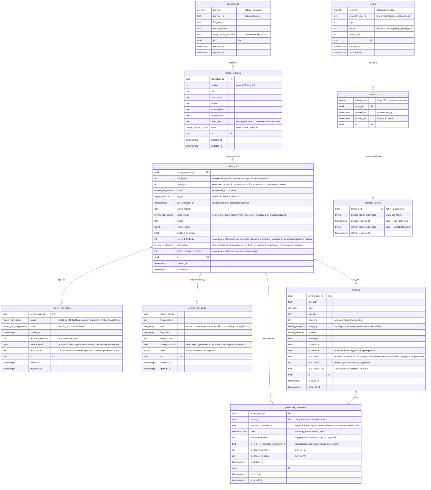

# Модель данных

Источник истины о структуре базы данных. Таблицы создаются миграцией
`alembic/versions/0001_baseline_schema.py`, пользователи и сессии — ревизией
`0005_add_users_and_sessions.py`, ссылка замечания на правило и итог
верификации — `0006_add_rule_ref_and_verification.py`, шаги прогона —
`0007_add_review_run_steps.py`, индекс `review_runs (updated_at, id)` под курсор
общего потока событий — `0008_add_review_runs_updated_at_index.py`, токен пользователя у
провайдера при сессии — `0007_add_provider_tokens.py`; отдельный тест следит, чтобы таблицы
на этой диаграмме и модели не расходились.

`ReviewRun` в тикете называется `ReviewJob`. Имя поменяли, потому что «job»
будет называться и сообщение в RabbitMQ, а когда долгоживущая строка в базе и
короткоживущее сообщение носят одно имя, люди в итоге отлаживают не то.

## Таблицы

**`repositories`**: репозиторий, который сервису разрешено ревьюить, одна строка
на хостинг. Здесь же лежит переключатель автоматического ревью для репозитория.

**`merge_requests`**: pull request в GitHub или merge request в GitLab. Хранит
то, что общее для всех его ревью: номер, заголовок, ветки, автора. `head_sha`
здесь означает последний коммит, замеченный на хостинге, и сдвигается с каждым
push. Новый прогон сверяется с ним, чтобы понять, устарел ли предыдущий.
`state` сведён к трём значениям, которые умеют выразить оба хостинга; адаптер
провайдера приводит `locked` из GitLab и closed-and-merged из GitHub к ним ещё
до записи.

**`review_runs`**: одна попытка проверить один коммит запроса на изменения. Его
`head_sha` указывает на проверенный коммит и никогда не меняется, поэтому
история остаётся понятной и после того, как запрос ушёл вперёд. `base_sha`
хранит вторую половину той же пары — ревизию, относительно которой считался
дифф: без неё по одному `head_sha` нельзя повторить тот же дифф, если целевая
ветка с тех пор сдвинулась. Строка ведёт
прогон по его жизненному циклу и хранит результат: причину сбоя, модель,
токены, длительность и количество отброшенных замечаний. `failed_stage`
запоминает этап, на котором прогон упал: после перехода в `failed` прежний
статус иначе теряется. Ограничение `ck_review_runs_failed_stage` разрешает
его только упавшему прогону и только из трёх этапов обработки —
`building_context`, `analysing`, `publishing`.
`verification` - итог второго прохода модели (Reflection Pass): `verified`, если верификатор ответил и его вердикты применены; `not_required`, если после отсева не осталось замечаний и второго вызова не было; `unavailable`, если верификатор упал или ответил не по форме и опубликованы замечания, прошедшие только отсев.
У прогонов, записанных до появления верификации, итог пуст.
`verifier_dropped_findings` - сколько замечаний отбросил верификатор; `rejected_findings` - сколько отбросил детерминированный отсев до него.
Имя намеренно не
совпадает с названием из очереди. Очередь живёт в RabbitMQ, и сообщение в ней
называется `ReviewJob`; строка живёт дольше своего сообщения в очереди на всё
время анализа и публикации и владеет их результатами.

**`review_run_steps`**: ход прогона для кабинета — по строке на шаг воркера:
этап, состояние, начало, длительность, токены и код ошибки. Этапы мельче
статуса прогона: `building_context` прогона — это шаги `fetching_diff` и
`building_context`, `analysing` — шаги `analysing` и `verifying`. Повтор этапа
(новая попытка вызова модели: ответ не по схеме, переход к резервному
провайдеру) — отдельная строка того же этапа, упавшая попытка остаётся
`failed` со своим кодом. Запросов и ответов модели здесь нет: шаг — исход, а
не телеметрия. Упавший верификатор — `failed`-шаг при завершённом прогоне:
второй проход fail-open.

**`context_payloads`**: ровно то, что было показано модели в рамках прогона, по
порядку, по строке на чанк, если контекст не влезает в один запрос. Благодаря
этому прогон воспроизводим: неудачное замечание можно отследить до входных
данных, которые его породили. По хешу следующий прогон с тем же содержимым
может переиспользовать payload, а не собирать его заново.

**`findings`**: те замечания модели, что пережили постобработку: привязаны к
строке, которую затронул дифф, без дубликатов, разложены по категориям.
Замечание по правилу владельца хранит ссылку на пункт: имя правила, номер пункта и копию его текста на момент прогона - правила в целевой ветке потом меняются, а префикс атрибуции в комментарии должен называть пункт, по которому замечание выпустили.
Замечание существует независимо от того, опубликовано оно или нет, поэтому оно
вынесено отдельно от следующей таблицы.

**`published_comments`**: то, что реально опубликовано на хостинге, и id,
который хостинг ему присвоил. Без этого id сервис не сможет потом отредактировать
или удалить собственный комментарий. Inline-комментарий ссылается на своё
замечание, итоговый комментарий прогона ни на что не ссылается, ответ в тред —
`thread_reply` с `in_reply_to_provider_comment_id`. `thread_resolved` отражает,
закрыт ли тред на хостинге (обновляется ботом, вебхуком `pull_request_review_thread`
и сверкой перед merge gate). `feedback_positive` / `feedback_negative` — оценки
комментария пользователями.

**`users`**: пользователь кабинета, одна строка на учётную запись у провайдера
входа. Логин, имя и аватар перезаписываются при каждом входе. Токен провайдера
хранится не здесь, а при сессии (`provider_tokens`): ревью работает через GitHub App,
токен пользователя нужен только списку и подключению репозиториев.

**`sessions`**: сессия входа. Значения cookie в базе нет, только SHA-256 от
него, поэтому утечка таблицы не даёт действующих cookie. Срок — 30 дней от
входа, без продления и без `updated_at`. Выход удаляет строку.

**`provider_tokens`**: токен пользователя GitHub App, полученный при входе, — одна
строка на сессию. Только шифротекст: AES-256-GCM с ключом `USER_TOKEN_ENCRYPTION_KEY`,
associated data — id сессии и имя поля, так что шифротекст, перенесённый в другую строку
или поле, не расшифровывается. Сроки `NULL` — токены без истечения. Строку обновляет
refresh под блокировкой `SELECT … FOR UPDATE`; удаляется она вместе с сессией. Сессии,
открытые до ревизии 0007, строки не имеют.

## Правила, которые обеспечивает схема

Это ограничения, а не соглашения, поэтому ни один путь в коде не сможет о них
забыть.

| Правило | Как |
|---|---|
| Репозиторий хранится одной строкой на хостинг | `UNIQUE (provider, provider_id)`. Один и тот же `full_name` на двух хостингах даёт две строки. |
| Номер запроса на изменения уникален в пределах репозитория | `UNIQUE (repository_id, number)` |
| Не больше одного незавершённого прогона на коммит | Частичный `UNIQUE (merge_request_id, head_sha) WHERE status NOT IN ('cancelled','completed','failed')`. Завершённый прогон не мешает повторному ревью. |
| Чанки контекста сохраняют порядок | `UNIQUE (review_run_id, chunk_index)` |
| Замечание не может повториться в одном прогоне | `UNIQUE NULLS NOT DISTINCT (review_run_id, file_path, side, old_line, new_line, category)`. Привязка заполняет только номер строки своей стороны, поэтому в ключе есть оба номера, а NULL считаются равными. Без любой из этих двух частей ограничение никогда не сработает на старой стороне, где `new_line` всегда NULL. |
| Ссылка на правило заполнена целиком или пуста целиком | `ck_findings_rule_ref`: `rule_name`, `rule_check`, `rule_check_text` все `NULL` либо все заполнены и `rule_check >= 1`. Префикс атрибуции строится из всех трёх частей. |
| Шаг закрыт целиком или идёт | `ck_review_run_steps_duration`: длительности нет ровно у `running`; `ck_review_run_steps_error_code`: код ошибки есть ровно у `failed`. Длительность и токены не отрицательны. |
| Счётчик верификатора не отрицателен | `ck_review_runs_verifier_dropped`: `verifier_dropped_findings >= 0` |
| Комментарий публикуется один раз за прогон | `UNIQUE NULLS NOT DISTINCT (review_run_id, finding_id)`. Именно правило для NULL распространяет это ограничение на итоговый комментарий прогона, у которого замечания нет. |
| Учётная запись провайдера — один пользователь | `UNIQUE (provider, provider_user_id)` |
| Сессия находится по cookie одним запросом | `UNIQUE (token_hash)` |
| Токен провайдера живёт не дольше сессии | `ON DELETE CASCADE` на `provider_tokens.session_id`: выход, вход поверх сессии, уборка истёкших и удаление пользователя удаляют и токен. Второе исключение из правила ниже, по той же причине. |
| Срок refresh token без самого токена не хранится | `ck_provider_tokens_refresh_expiry_needs_token`: `refresh_expires_at IS NULL OR refresh_token_encrypted IS NOT NULL` |
| Удаление пользователя гасит его сессии | `ON DELETE CASCADE` на `sessions.user_id` — единственное исключение из правила ниже: сессия без пользователя ничего не значит. |
| Удаление строки никогда не удаляет зависимые | `ON DELETE RESTRICT` на каждом внешнем ключе конвейера. Удаление, после которого что-то осталось бы без родителя, отклоняется, так что `provider_comment_id` опубликованного комментария и стоимость прогона не пропадут побочным эффектом. Очистка, когда она появится, удаляет дочерние строки явно. |

## Две вещи, которые стоит знать

**Частичному индексу нужен сборщик зависших прогонов.** Ограничение в один
незавершённый прогон на коммит не даёт повторно доставленному вебхуку запустить
второе ревью. Но из-за него же воркер, упавший посреди прогона, оставляет прогон
в нетерминальном статусе и навсегда блокирует этот коммит. Для этого и
существуют `last_progress_at` и `find_stale`; проход, который их использует,
появится вместе с воркером.

**В `context_payloads` лежит чужой исходный код.** Это чувствительная таблица.
Вычищать секреты нужно до вставки, а срок хранения здесь такой же вопрос защиты
данных, как и вопрос места на диске.
