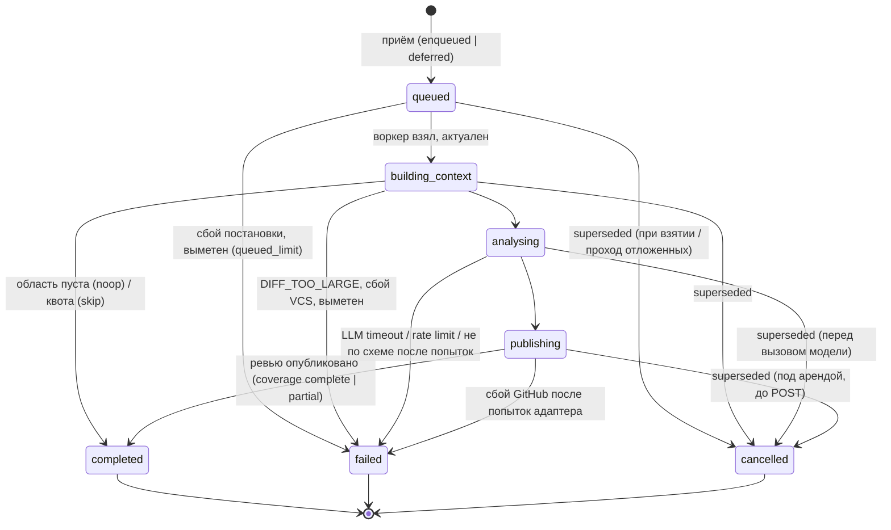
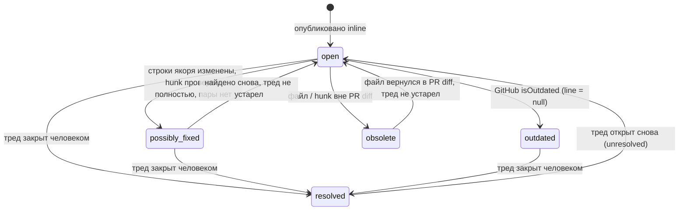

# Инкрементальное ревью, жизненный цикл замечаний и лимиты

**Статус:** Draft — архитектурное предложение, **не утверждено**.
**Владелец:** Tech Lead.
**OpenSpec change:** [`incremental-review-and-limits`](../../openspec/changes/incremental-review-and-limits/).

> Нормативные требования и сценарии — дельты спек в
> `openspec/changes/incremental-review-and-limits/specs/`; решения и альтернативы — его
> `design.md`. Этот документ сводит их в один читаемый вид и добавляет алгоритмы, диаграммы,
> таблицы лимитов и матрицу тестов. При расхождении приоритет у OpenSpec-артефактов. Словарь
> состояний, категорий и сущностей наследуется из `review-data-model` и
> [`PIPELINE_SPEC.md`](PIPELINE_SPEC.md).

---

## 1. Что есть сейчас

### 1.1 Реализовано (код + спеки)

| Область | Что есть | Где |
|---|---|---|
| Триггер | `opened`/`synchronize` → прогон `queued` + задача; `head_sha` запроса на изменение сдвигается на доставленный | `handle_webhook.py`, спека `webhook-intake` |
| Дифф | воркер берёт `compare/{base_sha}...{head_sha}` — **весь PR diff** на каждом push | `VcsGateway.fetch_diff`, `review_pipeline.py` |
| Дубли доставок | один нетерминальный прогон на `(merge_request_id, head_sha)`; после `completed` — ответ существующим; повтор упавших доставок ≤ 5 | частичный индекс, `find_active`/`find_reviewed`, `webhook_redelivery` |
| State machine | `queued → building_context → analysing → publishing → completed`, из любого нетерминального — `failed`/`cancelled`; терминальные окончательны | `app/domain/lifecycle.py` |
| Зависшие прогоны | `last_progress_at`, `stale_run_timeout_seconds` 1800, `queued_run_timeout_seconds` 21 600 | `app/domain/staleness.py` |
| Дубли находок | внутри прогона — `deduplicate`; между прогонами — `thread_coverage` по пути, стороне, категории и **текущей строке треда на GitHub** | `dedup.py`, `thread_coverage.py` |
| Треды | outdated не покрывает; закрытый человеком покрывает (кроме эскалации до `critical`); бот треды не закрывает, `threadFollowUps` игнорируются | спека `review-pipeline` |
| Публикация | маркер прогона в теле ревью, поиск по маркеру после потерянного ответа; check run merge gate по открытым `critical` | `publish_review.py` |
| Лимиты | `DIFF_MAX_BYTES` 5 МиБ → `failed`; `context_max_tokens` 32 000 → `omitted`; окно 65 536; `llm_max_attempts` 2; таймаут модели 300 с; тело вебхука 2 МиБ; фильтр шума `filter_diff_files` | `config.py`, `diff_parser.py` |
| Безопасность | HMAC constant-time до разбора; блоки `<<<untrusted>>>`; правила только с `base_sha`; модель без инструментов; верификатор не может отбросить `security` high/critical; ключи — `SecretStr` | threat model в `BACKEND_ARCHITECTURE.md` |

### 1.2 Запланировано, не построено

`RateLimiter`, `IdempotencyStore`, таблицы `accounts`, `idempotency_records`,
`rate_limit_counters`; редакция секретов в `context_payloads` (#28); уровни `surrounding` и
`whole_file`; индекс определений (`add-tree-sitter-index`); ретраи с backoff перед DLQ; тарифы и
приоритет очереди по тарифу; лимит длительности прогона.

### 1.3 Чего нет вовсе (предмет этого предложения)

Водяной знак проверенного состояния; отличие нового кода от проверенного; переход в `cancelled`
(в него не ведёт ни один путь кода); ограничение параллельных прогонов одного PR; fingerprint
находки; состояние «возможно исправлено»; лимиты частоты, токенов прогона, квоты; явное
покрытие (сегодня `omitted` не делает прогон частичным).

### 1.4 Утверждённые контракты, которые предложение затрагивает

- `webhook-intake` «Действия opened и synchronize запускают ревью», «Тело 202 приёма вебхука» —
  **MODIFIED** (вытеснение, лимиты, поле `intake_outcome`).
- `review-data-model`, `review-rest-api` — только **ADDED** (новые поля и сущности).
- `review-pipeline` (покрытие тредом, «Ответ модели не закрывает тред», «Ревью не публикуется
  дважды», merge gate) — **не меняются**; новое сопоставление встраивается в них.
- `ReviewRunStatus`, тело сообщения очереди, `finding.schema.json` ответа модели — **не
  меняются**.

---

## 2. Термины

| Термин | Определение |
|---|---|
| **PR diff** `D(B,H)` | `compare(B...H)` — изменения ветки PR относительно merge-base с целевой веткой; то, что видит GitHub и к чему привязываются комментарии |
| **Incremental diff** `I(L,H)` | `compare(L...H)` — изменения между водяным знаком `L` и новым head `H`; определён, только если `L` — предок `H` |
| **Hunk digest** | `sha256(path_at_H ‖ строки hunk'а с маркерами ' '/'+'/'-' без @@-заголовка, trailing whitespace снят)` — не зависит от номеров строк |
| **Config digest** | `sha256(версия промпта ‖ дайджест правил на base_sha ‖ версия сборки контекста)` |
| **Журнал** | `reviewed_hunks(merge_request_id, hunk_digest, config_digest, review_run_id)` — какие hunk'и уже проверены |
| **Область ревью** `S` | hunk'и `D(B,H)` после фильтра шума, чей `(hunk_digest, config_digest)` не в журнале |
| **Водяной знак** `L` | `merge_requests.last_reviewed_head_sha` — head последнего прогона `completed` с покрытием `complete` |
| **Покрытие** | по файлам: `reviewed`, `filtered`, `skipped_limit`, `skipped_budget`; по прогону: `complete`, `partial`, `none` |

Ключевое различие: **замечание привязывается только к PR diff**; incremental diff — служебный
сигнал (режим, «изменено с прошлого ревью», `possibly_fixed`). Предмет ревью — область `S`.

---

## 3. Поток после нового push

```mermaid
sequenceDiagram
    autonumber
    participant GH as GitHub
    participant API as app/api (приём)
    participant DB as PostgreSQL
    participant MQ as RabbitMQ
    participant W as app/worker
    participant LLM as LlmGateway

    GH->>API: pull_request.synchronize (HMAC)
    API->>API: подпись, лимит тела
    API->>DB: устаревшая доставка? (pr.updated_at < head_updated_at)
    alt устарела
        API-->>GH: 202 ignored / stale_event
    else
        API->>DB: дубль? лимиты (decide_admission)
        API->>DB: MR.head_sha := H; новый run(queued); активный run(H_old) помечен superseded_by
        API->>MQ: enqueue(job) — или defer
        API-->>GH: 202 ReviewJob / enqueued | deferred | duplicate
    end
    MQ->>W: job(run_id, H, B)
    W->>DB: run терминален? MR.head_sha ≠ H → cancelled(superseded)
    W->>GH: compare(B...H) = PR diff; compare(L...H) — статус и переименования
    W->>DB: журнал (hunk_digest, config_digest)
    W->>W: S := PR diff − журнал − фильтр; plan_scope(S, бюджет, лимиты)
    alt S пуст
        W->>GH: check run на H по открытым тредам
        W->>DB: run completed / noop
    else
        W->>DB: актуален? (перед вызовом)
        W->>LLM: ревью только S (+ контекст, разметка «изменено с L»)
        W->>W: отсев, верификатор (в пределах бюджета)
        W->>DB: аренда публикации; актуален?; match_findings
        W->>GH: ревью (только новые находки) + check run
        W->>DB: published_comments, reviewed_hunks(S_reviewed), lifecycle, знак (CAS), completed
    end
```

---

## 4. Алгоритм области ревью

### 4.1 Определение режима

```text
mode(mr, H, B):
    L := mr.last_reviewed_head_sha
    if L is null:                                 return FULL
    if H == L:                                    return NOOP          # дубль, обычно отсекает приём
    cmp := vcs.compare(L, H)                      # статус и файлы; ошибка → REBASED
    if cmp.status == "ahead":                     return INCREMENTAL
    return REBASED                                # diverged | behind | 404 (force-push, rebase, GC)
```

Смена base-ветки (`B` новый) режим не меняет: PR diff строится от нового `B`, журнал отсекает
уже проверенное, новые hunk'и из-за смены base попадают в `S`.

### 4.2 Вычисление области

```text
review_scope(pr_files, ledger, config_digest, policy) -> Scope:      # чистая
    files := filter_noise(pr_files, policy)          # filter_diff_files + .gitattributes + @generated
    for f in files: for h in f.hunks:
        d := hunk_digest(f.path_at_head, h)
        if (d, config_digest) in ledger: h.status := ALREADY_REVIEWED
        else:                            h.status := IN_SCOPE
    return Scope(in_scope, filtered, already_reviewed)

plan_scope(scope, budget, limits) -> (selected, skipped):            # чистая
    order := sort(scope.in_scope, key=(class(path), path))      # src < tests < config/docs
    take while files ≤ REVIEW_MAX_FILES and lines ≤ REVIEW_MAX_CHANGED_LINES
               and estimate_tokens(selected) ≤ min(context_max_tokens, budget.remaining)
    rest → skipped_limit | skipped_budget
```

`changed_since_L` — разметка внутри выбранных hunk'ов: строки, которые `I(L,H)` меняет
(только в `INCREMENTAL`). Попадает в пакет как атрибут блока (`context-payload/v2`), чтобы
модель сосредоточилась на новом, но **якорь проверяется по PR diff**.

### 4.3 Правила, гарантирующие отсутствие пропусков

1. Hunk попадает в журнал **только** при `completed` прогона, который его проверил и опубликовал
   (или покрыл тредами) находки по нему.
2. `failed`, `cancelled`, `skipped_*` журнал не пополняют.
3. Знак сдвигается только при `coverage=complete`, CAS по знаку на начало прогона.
4. Область считается от журнала, а не от знака, поэтому ошибка или отставание знака даёт
   лишние токены, но не пропуск.

### 4.4 Таблица случаев

| Случай | Режим | Что получает модель |
|---|---|---|
| Первое ревью | `full` | все hunk'и после фильтра (в пределах лимитов) |
| Push поверх проверенного | `incremental` | hunk'и, содержимое которых изменилось |
| Несколько коммитов в одном push | `incremental` | то же — считается разница `L…H`, а не по коммиту |
| Push только lock-файлов / пустой | `noop` | ничего; check run переносится на новый head |
| Merge целевой ветки в PR | `incremental` | только hunk'и PR diff; чужие изменения из base в `S` не входят |
| Rebase без конфликтов + force-push | `rebased` | обычно ничего: дайджесты hunk'ов те же |
| Force-push с переписанной историей | `rebased` | все hunk'и, которых нет в журнале |
| Смена целевой ветки | по `L` | hunk'и, появившиеся от смены base |
| Предыдущий прогон `partial` | любой | непроверенный остаток + новое |
| Нет успешного ревью, были `failed` | `full` | всё, кроме записанного в журнал |

---

## 5. State Machine прогона

Статусы **не меняются**. Новое — атрибуты `review_mode`, `since_sha`, `coverage`,
`coverage_reason`, `cancel_reason`, `superseded_by_run_id`, `defer_reason` и переходы в
`cancelled`, которые раньше не использовались.



**Изменение таблицы переходов:** `building_context → completed` (noop/skip) — сегодня из
`building_context` разрешены только `analysing`, `failed`, `cancelled`. Это единственная правка
`_ALLOWED`; альтернатива без неё — проходить `analysing → publishing` вхолостую, что
искажает шаги прогона. Требует согласования Backend.

### 5.1 Когда можно сдвигать `last_reviewed_head_sha`

Только в транзакции `publishing → completed` (или `building_context → completed` для `noop`)
при `coverage=complete` и `UPDATE … WHERE last_reviewed_head_sha IS NOT DISTINCT FROM :since_sha`.
`noop` сдвигает знак: область пуста значит, что весь PR diff на `H` уже в журнале.

### 5.2 Конкурентные сценарии

| Сценарий | Поведение |
|---|---|
| Новый push при выполняющемся ревью | новый прогон создан; старый → `cancelled(superseded)` на ближайшей проверке; ничего не публикует |
| Несколько последовательных push | в очереди отменяются при взятии; ревью публикует последний; его область покрывает всё непроверенное |
| Повторная доставка одного webhook | существующий прогон, `intake_outcome=duplicate` (как сегодня) |
| Повторная доставка **старого** push | `stale_event`: head не откатывается, прогона нет |
| Устаревшая задача в очереди | `cancelled(superseded)` без диффа и модели, `ack` |
| Отмена / замена job | только через вытеснение или закрытие PR (`cancel_reason=pull_request_closed`, требует обработки `closed`) |
| LLM timeout | повторы адаптера (`llm_max_attempts`), затем `failed` / `analysing`; журнал и знак не трогаются |
| Частичное ревью | `completed`, `coverage=partial`, журнал — только проверенное, знак не сдвигается |
| Превышение квот | `defer` (частота, backpressure) или `skip` (квота токенов) — раздел 7 |
| Ошибка публикации | `failed` / `publishing`; журнал не пополнен; следующий прогон проверит снова; маркер защищает от двойного ревью |
| Повтор после сбоя | новый прогон по повторной доставке, пока не исчерпан бюджет повторов коммита |
| Два прогона дошли до публикации | аренда публикации на `merge_requests`; второй ждёт и сопоставляет с только что опубликованным |
| Воркер упал под арендой | аренда истекает; прогон выметается в `failed` |

---

## 6. Сопоставление и жизненный цикл замечаний

### 6.1 Fingerprint

```text
fingerprint       = sha256(category ‖ rule_name#check|"" ‖ file_identity ‖ norm(anchor_line_text) ‖ enclosing_symbol|"")
fingerprint_loose = sha256(category ‖ rule_name#check|"" ‖ file_identity ‖ enclosing_symbol|"")
norm(s)           = схлопнуть пробельные символы, обрезать края; NFC
file_identity     = путь на H; при переименовании — цепочка previous_filename из compare
```

Не входят: номер строки (сдвигается), текст замечания модели (нестабилен между прогонами),
серьёзность (эскалация — отдельное правило).

### 6.2 Алгоритм `match_findings` (чистая функция)

```text
match_findings(candidates, previous, host_lines, renames, window) -> [Match]:
    pairs := []
    for c in candidates, p in previous (open | possibly_fixed | outdated | resolved):
        if   host_lines[p.thread] == c.line and same(path, side, category): level := L0_HOST_LINE
        elif p.fingerprint == c.fingerprint:                                  level := L1_EXACT
        elif p.fingerprint_loose == c.fingerprint_loose
             and p.enclosing_symbol and |mapped_line(p) - c.line| ≤ window:  level := L2_LOOSE
        else: continue
        pairs += (level, |mapped_line(p) - c.line|, p.id, c.id)
    sort pairs by (level, distance, p.id, c.id)            # детерминизм
    greedy: берём пару, если ни p, ни c ещё не заняты      # взаимно-однозначно
    остальные кандидаты → NEW
```

Далее совпадение проходит **действующие** правила `review-pipeline`: открытый тред с
серьёзностью ≥ находки — покрывает (`covered_by_finding_id`); закрытый человеком — покрывает,
кроме эскалации до `critical`; **outdated — не покрывает**: находка публикуется и получает
`reappeared_from`. Если сверка с GitHub упала, уровень L0 недоступен, но L1/L2 по базе
продолжают подавлять дубли — сегодня в этом случае находки публикуются без сверки.

| Ситуация | Как распознаётся |
|---|---|
| Дубликат | L0 или L1 |
| Перемещение строки | L0 (GitHub сдвинул тред) или L1 (тот же текст строки) |
| Переименование файла | `file_identity` через `previous_filename` |
| Изменение контекста | L2 внутри того же определения и окна строк |
| Повторное появление | совпадение с `possibly_fixed`/`outdated`/`resolved` → `reappeared_from` |
| Неоднозначность | жадно по (уровень, расстояние, id); без пары — новая |

### 6.3 Внутренние состояния замечания

Хранятся на корневой находке треда (`findings.lifecycle_state`).



Переходы — только по фактам кода (дифф, журнал, вебхук треда), **никогда по ответу модели**.
Новая находка при `outdated`-треде публикуется как новая с `reappeared_from` — прежнее
замечание остаётся `outdated`.

### 6.4 Соответствие GitHub

| Внутреннее | GitHub | Merge gate |
|---|---|---|
| `open` | тред открыт, не outdated | `critical` блокирует |
| `possibly_fixed` | тред открыт (бот не закрывает и не отвечает) | `critical` **блокирует** до закрытия человеком |
| `outdated` | тред открыт, `isOutdated=true` | открытый `critical` блокирует (как сегодня) |
| `obsolete` | тред открыт или outdated | как сегодня — по открытости треда |
| `resolved` | тред закрыт (`pull_request_review_thread.resolved`) | не блокирует |

Отсутствие находки в ограниченном ревью — **не** исправление: `possibly_fixed` требует всех
трёх фактов (раздел 6.3); в `rebased`, при `partial` для этого hunk'а и в отменённом прогоне
состояние не меняется.

---

## 7. Rate limits и Cost Quotas

Все значения — **предложение, требует согласования** (Backend, Queue, DevOps, LLM). По
умолчанию каждый новый лимит выключен до решения команды.

| # | Уровень | Параметр | Предложение | Обоснование | Поведение |
|---|---|---|---|---|---|
| 1 | Edge | nginx `limit_req` на `/api/v1/webhooks` | 20 r/s на IP, burst 50 | GitHub шлёт с ограниченного набора адресов; дешёвый первый эшелон | 503 от nginx (до приложения) — **DevOps** |
| 2 | Приём | `WEBHOOK_RATE_PER_INSTALLATION` | 300 / 5 мин | на порядок выше нормальной активности; защита от шторма доставок | `reject` → 202 `rate_limited` |
| 3 | Приём | `REVIEW_RUNS_PER_PR_WINDOW` | 10 / час | обычный PR — единицы push в час | `defer` |
| 4 | Приём | `REVIEW_RUNS_PER_REPO_WINDOW` | 60 / час | ограничивает монорепо с ботами | `defer` |
| 5 | Приём | `QUEUE_BACKPRESSURE_DEPTH` | 200 ожидающих | при ~1–3 мин на прогон и 1 воркере — часы хвоста | `defer` (`backpressure`) |
| 6 | Воркер | активных прогонов на PR | 1 публикующий (аренда) | раздел 5 | вытеснение |
| 7 | Воркер | параллельные вызовы LLM | = число реплик воркера × prefetch 1 | Ollama на одном GPU; явный семафор — только при >1 реплике | очередь |
| 8 | Воркер | `DIFF_MAX_BYTES` | 5 МиБ (как сейчас) | не меняется | `failed` `DIFF_TOO_LARGE` |
| 9 | Воркер | `REVIEW_MAX_FILES` | 50 после фильтра | ≈ предел осмысленного ревью и одного пакета | `partial` |
| 10 | Воркер | `REVIEW_MAX_CHANGED_LINES` | 2 000 в области | ~32k токенов пакета ≈ 1,5–2,5 тыс. строк диффа с контекстом | `partial` |
| 11 | Воркер | `REVIEW_RUN_TOKEN_BUDGET` | 100 000 (вход+выход, все вызовы) | ревью 32k+4k, верификатор ≈ столько же, плюс 1 повтор | `partial` / без верификатора |
| 12 | Квота | `QUOTA_TOKENS_PER_INSTALLATION_DAY` | 2 000 000 | ≈ 20–40 полных прогонов в сутки | `skip` (`quota`), check run `neutral` |
| 13 | Повторы | `llm_max_attempts` | 2 (как сейчас) | | `failed` |
| 14 | Повторы | `MAX_FAILED_RUNS_PER_COMMIT` | 3 | 1 исходный + 2 повтора доставки; дальше сбой детерминирован | `reject` → 202 `retry_budget_exhausted` |
| 15 | Повторы | сообщение очереди | `nack` без requeue → DLQ (как сейчас) | нет бесконечного круга | DLQ |
| 16 | Повторы | `PUBLISH_LEASE_SECONDS` / ожидание | 180 с / 60 с | > бюджета ожидания адаптера GitHub (60 с на запрос) | повторная постановка задачи |

**Отложенные прогоны** (`defer`): прогон создаётся в `queued` с `defer_reason` и без задачи;
проход воркера (рядом со `stale_sweep`, интервал ~60 с) ставит в очередь последний отложенный
прогон каждого PR, когда окно и очередь позволяют, остальные — `cancelled(superseded)`. Порог
`queued_run_timeout_seconds` (6 ч) выше окна лимита — отложенный прогон не выметается раньше
времени.

**Фильтрация шума** — `filter_diff_files` (lock-файлы, `*.min.*`, `*.generated.*`, `*.pb.go`,
бинарные, `vendor/`, `node_modules/`) плюс: `linguist-generated`/`linguist-vendored` из
`.gitattributes` на `base_sha` (тот же путь чтения и кэш, что у `.review/rules.md`), маркер
`@generated` в первых 5 строках, видимых в диффе. Предлагается обсудить: `dist/`, `build/`,
`__snapshots__/`, строки длиннее 1 000 символов как признак минификации. Отфильтрованное —
`filtered` в покрытии, не делает его `partial`.

**Сводка поведений:** `reject` — защита от злоупотребления, кода не теряет (следующий push
доберёт по журналу); `defer` — справедливость и сглаживание пиков; `skip` — бюджет денег
исчерпан, видно в check run; `partial` — ревью важного в пределах бюджета, остаток явно
перечислен и не попадает в журнал.

---

## 8. Безопасность

| Угроза | Мера | Статус |
|---|---|---|
| Поддельный вебхук | HMAC-SHA256 по сырому телу, constant-time, до разбора; пустой секрет отклоняет всё | есть |
| Повторная доставка | естественный ключ `(MR, head_sha)`; `stale_event` по времени обновления PR; `X-GitHub-Delivery` пишется в лог; `IdempotencyStore` — когда появится первая ручка с повторами | новое: `stale_event` |
| Шторм доставок / DoS | nginx `limit_req`, лимит тела 2 МиБ, лимиты 2–5 раздела 7, ответ 202 без повторов | новое |
| Бесконечные повторы | DLQ без requeue, `MAX_FAILED_RUNS_PER_COMMIT`, повтор доставок ≤ 5, бюджет токенов | новое: бюджеты |
| Изоляция репозиториев | каждый запрос к журналу, находкам и аренде — по `merge_request_id` своего репозитория; `installation_id` только из подписанного payload; видимость прогонов по токену пользователя | есть + требование к новым таблицам |
| Prompt injection | блоки `<<<untrusted>>>`, санитизация служебных токенов, модель без инструментов, вывод — только схема; **новое**: тексты прошлых находок и их состояния в запрос не попадают; состояния замечаний меняет только код; `threadFollowUps` по-прежнему игнорируются | есть + новое |
| Подавление находки через инъекцию | `possibly_fixed` не по ответу модели; merge gate — по открытости треда; верификатор не снимает `security` high/critical | есть + новое |
| Исполнение недоверенного кода | репозиторий не клонируется, код PR не собирается и не запускается; tree-sitter парсит текст с лимитами размера; предложение — вынести парсинг в подпроцесс с лимитом памяти/времени (инцидент segfault #227) | открытый вопрос |
| Учётные данные | GitHub App: приватный ключ и webhook secret — секреты окружения/CI, installation-токены краткоживущие; ключи Eurorouter — `SecretStr`, ротация; токены пользователей — AES-256-GCM; журнал хранит только дайджесты | есть |
| Логи | без тел диффов, кода, текстов находок и секретов; `log_redaction` для query; новые поля логов — id, sha, дайджесты, коды причин | есть + требование |
| Доступ к результатам | API прогона и покрытия — сессия + видимость репозитория по токену пользователя; комментарии на GitHub видны всем читателям репозитория — для публичных репозиториев находки `security` раскрывают уязвимость публично | открытый вопрос |
| Секреты в `context_payloads` | редакция до вставки (#28) — не построена | риск остаётся |

---

## 9. Изменения контрактов

| Контракт | Изменение | Совместимость | Компоненты |
|---|---|---|---|
| `ReviewRunStatus` | без изменений; начинает использоваться `cancelled` | клиент уже поддерживает | — |
| Таблица переходов | `building_context → completed` (noop/skip) | внутреннее | domain `lifecycle` |
| `ReviewJob` (API, SSE `run.*`, строка списка) | + `review_mode`, `since_sha`, `coverage`, `coverage_reason`, `cancel_reason`, `superseded_by`, `defer_reason` (nullable) | аддитивно; клиент игнорирует незнакомое | API, Frontend |
| Находка в API | + `lifecycle_state`, `match_level`, `reappeared_from`; fingerprint не отдаётся | аддитивно | API, Frontend |
| `finding.schema.json` | **не меняется** (общая схема ответа модели и API) — новые поля только в модели ответа API | требует решения: схема объявлена общей для обоих | LLM, API |
| `GET /reviews/{id}/coverage` | новая ручка, сначала заглушка `501` | новая | API, Frontend |
| Тело 202 вебхука | + `intake_outcome` | аддитивно; GitHub тело не читает | API |
| Webhook processing | `synchronize` вытесняет; `stale_event`; лимиты; предложено: `closed` → отмена, `edited` со сменой base → прогон | MODIFIED `webhook-intake` | API |
| Сообщение очереди `ReviewJob` | **без изменений** | — | Queue |
| Пакет контекста | `context-payload/v2`: атрибут `changed_since_review` у строк hunk'а; область вместо всего PR diff | версия пакета; промпт объясняет атрибут | LLM, Context |
| Ответ модели | без изменений; опционально `issue_type` (открытый вопрос) | — | LLM |
| Error model | коды причин: `TOKEN_BUDGET_EXCEEDED`, `QUOTA_EXCEEDED`, `REVIEW_SUPERSEDED` (причина отмены), `RATE_LIMITED`; новых HTTP-ошибок наружу нет | новые значения enum | API, Frontend |
| БД | `merge_requests`: знак, `head_updated_at`, аренда; `review_runs`: режим, покрытие, причины; `findings`: fingerprint(ы), `lifecycle_state`, `match_level`, `reappeared_from_finding_id`; `reviewed_hunks`, `review_run_files`, `rate_limit_counters` | миграции, nullable | Backend |
| Frontend | статус `cancelled` с причиной «заменён новым push» и ссылкой; бейдж режима и «проверено с `sha`»; покрытие `partial` со списком файлов; `skip`/`defer` с объяснением; состояние замечания | аддитивно | Frontend |

---

## 10. Тестовые сценарии

| # | Сценарий | Ожидаемый результат | Спека |
|---|---|---|---|
| 1 | Первое ревью PR | `full`; область — все hunk'и после фильтра; `completed`/`complete`; журнал заполнен; знак = H | incremental-review |
| 2 | Push с исправлением одного замечания | `incremental`; модель получает только изменённые hunk'и; замечание → `possibly_fixed`; тред открыт; `critical` держит merge gate | incremental-review, finding-tracking |
| 3 | Push без изменений, требующих анализа | `noop`; модель не вызвана; ревью нет; check run на новом head | incremental-review |
| 4 | Повторное обнаружение той же проблемы | L0/L1; inline нет; `covered_by_finding_id` | finding-tracking |
| 5 | Перемещение строки с замечанием | fingerprint тот же; находка покрыта тредом | finding-tracking |
| 6 | Force-push или rebase | `rebased`; область — только hunk'и не из журнала; повторных inline нет | incremental-review |
| 7 | Несколько push во время LLM processing | промежуточные → `cancelled(superseded)`; публикует только последний | incremental-review |
| 8 | Повторная доставка webhook | 202 `duplicate`; новых записей и задач нет | webhook-intake |
| 9 | Большой PR с lock-файлами | lock/generated/vendor → `filtered`; сверх лимита → `skipped_limit`; `partial` | review-limits |
| 10 | Превышение token budget | `partial` / `token_budget`; знак не сдвинут; непроверенное в сводке | review-limits |
| 11 | LLM timeout / rate limit / malformed output | `failed` / `analysing` с кодом; журнал и знак прежние; повтор до бюджета | review-limits |
| 12 | Worker crash и повторное выполнение | выметен в `failed`; новый прогон проверяет всё не из журнала | incremental-review |
| 13 | Ошибка GitHub API при публикации | `failed` / `publishing`; журнал не пополнен; следующий прогон проверит снова | incremental-review |
| 14 | Частичное ревью | проверенное — в журнале; остальное — в следующем прогоне | incremental-review |
| 15 | Prompt injection через содержимое PR | состояние замечания не меняется; тред не закрыт; check run `failure` | finding-tracking |

Все решающие функции (`review_scope`, `plan_scope`, `hunk_digest`, `fingerprint`,
`match_findings`, `next_lifecycle_state`, `decide_admission`) — чистые и покрываются
юнит-тестами без сети; сценарии 6, 7, 12, 13 — интеграционные с фейками `VcsGateway`/`LlmGateway`
в песочнице воркера (#229).

---

## 11. План реализации

Разбивка по компонентам и порядок — `openspec/changes/incremental-review-and-limits/tasks.md`.
Фазы: (1) схема и теневая запись fingerprint/покрытия; (2) область ревью и вытеснение за флагом;
(3) сопоставление и состояния замечаний; (4) лимиты и квоты; (5) API и фронтенд; (6) документы.

---

## 12. Открытые вопросы

| # | Вопрос | Рекомендация | Кому |
|---|---|---|---|
| 1 | Аренда публикации и повторная постановка задачи вместо ожидания в воркере — ок для RabbitMQ? | да; без новой инфраструктуры | Queue, Backend |
| 2 | Debounce отложенной доставкой (TTL-очередь + DLX)? | нет на MVP: вытеснение при взятии достаточно | Queue, DevOps |
| 3 | `config_digest`: включать правила владельца? id модели? | правила — да; модель — нет (фоллбэк Eurorouter иначе инвалидирует журнал) | LLM, Backend |
| 4 | Поле `issue_type` из закрытого словаря в ответе модели для fingerprint | обсудить после замеров L1/L2 в теневом режиме | LLM |
| 5 | `finding.schema.json` общая для LLM и API — новые поля API ломают это правило | разделить схему ответа модели и схему находки API | LLM, Frontend, QA |
| 6 | Писать ли боту в тред при `possibly_fixed` (детерминированный текст, без закрытия)? | нет: шум, и не снимает gate | Frontend, продукт |
| 7 | Обрабатывать `closed` (отмена) и `edited` со сменой base (новый прогон)? | да, отдельными задачами | Backend |
| 8 | Ключ квот — инсталляция или репозиторий, пока нет `accounts`? | инсталляция | Backend, продукт |
| 9 | Все числовые значения раздела 7 | согласовать после нагрузочного прогона (`load.yml`) | DevOps, Queue, LLM |
| 10 | Изоляция tree-sitter в подпроцессе | да, отдельным change | Backend, DevOps |
| 11 | Находки `security` в публичных репозиториях публикуются открыто | решение продукта: сводка без деталей или только в кабинете | продукт, Security |
| 12 | Ручной перезапуск (`trigger=manual`) для добора `partial`/`skip` | да, после этого change | Backend, Frontend |
| 13 | Импорт комментариев упавшего под арендой прогона по маркеру | да, расширение существующего поиска | Backend |
| 14 | Хранение `reviewed_hunks` — срок жизни после закрытия PR | хранить, пока не появится политика очистки | Backend, DevOps |

## 13. Риски

Перечень с митигациями — `design.md`, раздел «Risks / Trade-offs». Главные: дубли после падения
под арендой; ложное подавление на уровне L2; полный повтор по всем PR при смене правил; секреты
в `context_payloads` до #28; раскрытие находок `security` в публичных PR.
