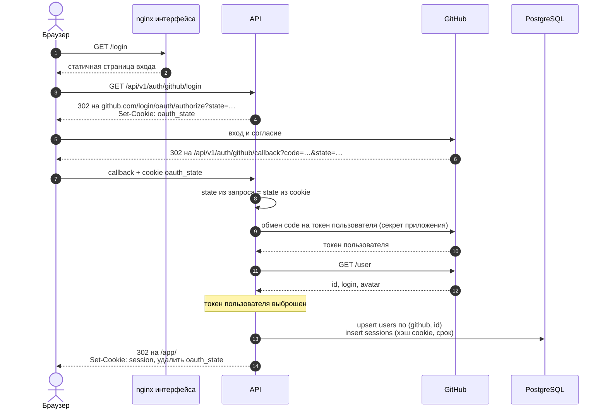
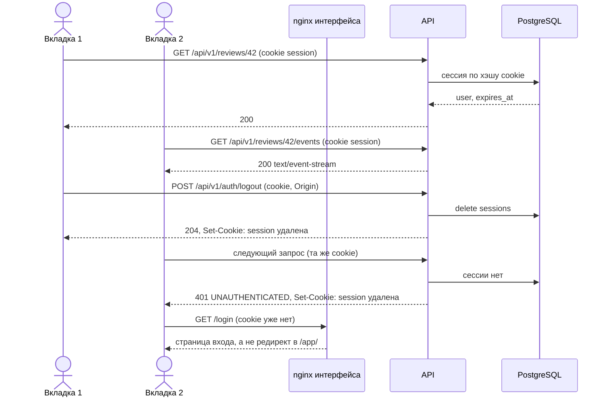

## Context

Пользовательской аутентификации в сервисе нет: ручки `/api/v1` открыты, единственная проверка — подпись вебхуков. С GitHub бэкенд работает как GitHub App: `GitHubVcsGateway` выпускает installation-токен на установку и ходит за диффом и комментариями от имени приложения (`docs/BACKEND_ARCHITECTURE.md`).

`PIPELINE_SPEC.md` §9.1 и `openapi.yaml` описывают предложение: `POST /auth/oauth/token` и `POST /auth/refresh`, access-токен в теле и в памяти вкладки, refresh-токен в httpOnly cookie. Кабинет ui#16 сделан под это предложение на моке.

Интерфейс и API отдаются с одного origin: nginx интерфейса проксирует `/api/` на API. Приложение живёт под `/app/`, страница входа — статичная `/login` (ui#24). Статус прогона приходит по SSE через нативный `EventSource` (ui#20).

## Goals / Non-Goals

**Goals:**

- Вход через GitHub и GitLab, общий для всех вкладок браузера.
- Выход и отзыв сессии действуют сразу.
- Ни один токен не доступен JS страницы.
- SSE и обычные запросы авторизуются одинаково, без заголовков.

**Non-Goals:**

- Клиенты API на другом origin и мобильные приложения. Если появятся, им выдаются отдельные токены рядом с сессиями.
- Роли и права на репозитории: кто может регистрировать репозиторий и запускать ревью (api#41) — отдельный change поверх этого.
- Список установок GitHub App пользователя и подключение репозиториев.
- Хранение токенов пользователей у провайдеров.

## Decisions

### Сессия в cookie вместо access- и refresh-токенов

| | access + refresh (§9.1) | сессия в cookie |
| --- | --- | --- |
| Токен в JS | access-токен в памяти вкладки | нет |
| Вкладки | у каждой свой access-токен | одна сессия на все |
| Выход | действующие access-токены живут до истечения | удаление строки, сразу везде |
| Ротация refresh | гонка вкладок; повторное использование отзывает сессию | не нужна |
| SSE | заголовок — нужна библиотека и обновление токена в потоке | нативный `EventSource` |
| CSRF | не подвержен | `SameSite=Lax` и проверка `Origin` |
| Хранение на бэкенде | refresh-токены, иначе нет отзыва | сессии |

Хранение нужно в обоих вариантах: без хранения refresh-токенов их не отозвать. Значит, выигрыш access-токена — проверка без обращения к базе — оплачивается сложностью на обеих сторонах. Проверка сессии — один запрос по уникальному индексу.

### Значение cookie и хранение

Значение cookie — 32 случайных байта (`secrets.token_urlsafe(32)`), без структуры и подписи. В `sessions` лежит SHA-256 от него: утечка таблицы не даёт действующих cookie. Поиск — по уникальному индексу на хэше.

Срок жизни сессии — 30 дней от входа, без продления. Просроченная сессия при обращении считается недействительной и удаляется. Периодическая чистка — отдельная задача, когда таблица начнёт расти.

### Атрибуты cookie

`session=<значение>; HttpOnly; Secure; SameSite=Lax; Path=/; Max-Age=2592000`.

- `HttpOnly` — недоступна JS.
- `Path=/` — уходит и на `/api/`, и на `/login`: по ней nginx интерфейса уводит вошедшего со страницы входа в приложение.
- `SameSite=Lax`, а не `Strict`: со `Strict` переход по ссылке из комментария на GitHub открывал бы приложение без сессии. `Lax` не отправляет cookie с изменяющими запросами с чужих сайтов.

### OAuth на бэкенде

1. `GET /api/v1/auth/{provider}/login` генерирует `state`, кладёт его в cookie `oauth_state` (`HttpOnly; Secure; SameSite=Lax; Path=/api/v1/auth; Max-Age=600`) и отвечает `302` на страницу авторизации провайдера.
2. Провайдер возвращает на `GET /api/v1/auth/{provider}/callback?code=…&state=…`. `SameSite=Lax` пропускает `oauth_state` с этим переходом верхнего уровня.
3. Бэкенд сверяет `state` с cookie, обменивает `code` на токен пользователя секретом приложения и одним запросом получает профиль: `GET /user` у GitHub, `GET /api/v4/user` у GitLab.
4. Находит или создаёт пользователя по паре `provider` + `provider_user_id`, обновляет логин, имя и аватар.
5. Создаёт сессию, ставит cookie `session`, удаляет `oauth_state` и отвечает `302` на `/app/`.



Токен пользователя после шага 3 не сохраняется. Ревью продолжает работать через installation-токены GitHub App.

Ошибка на любом шаге — `302` на `/login?error=<код>`: `state_mismatch`, `denied` (пользователь отказал у провайдера), `provider_unavailable`. Сессия не создаётся.

Для GitHub используется OAuth самого GitHub App (его `client_id` и `client_secret`), а не отдельное OAuth App: один реестр приложения, и пользователь видит одно приложение.

### Какие ручки требуют сессию

Требуют: все ручки `/api/v1`, кроме `/webhooks/*` (у них своя проверка подписи), `/auth/{provider}/login`, `/auth/{provider}/callback` и `/health`. В том числе `GET /api/v1/reviews/{id}/events` (SSE).

Без сессии — `401` с `ApiError.code = UNAUTHENTICATED`. Если cookie `session` пришла, но недействительна, тот же ответ её удаляет (`Max-Age=0`). Так nginx интерфейса перестаёт считать пользователя вошедшим, и страница входа не уводит его обратно в приложение по кругу.

Проверка — зависимость FastAPI на уровне роутера, а не middleware: исключения видны в объявлении маршрутов.

Рабочие запросы, протухшая сессия и выход:



### CSRF

`SameSite=Lax` не отправляет cookie с `POST` с чужого сайта, но защита не должна держаться на одном атрибуте. Изменяющие запросы (`POST`, `PUT`, `PATCH`, `DELETE`) к ручкам с сессией сверяют заголовок `Origin` с `PUBLIC_ORIGIN`. Нет `Origin` или он чужой — `403` с `ApiError.code = ORIGIN_FORBIDDEN`. Вебхуки под проверку не попадают: у них нет cookie и своя подпись.

### Данные

```text
users
  id                uuid PK
  provider          text NOT NULL            -- github | gitlab
  provider_user_id  text NOT NULL
  login             text NOT NULL
  name              text NULL
  avatar_url        text NULL
  created_at        timestamptz NOT NULL
  updated_at        timestamptz NOT NULL
  UNIQUE (provider, provider_user_id)

sessions
  id                uuid PK
  token_hash        bytea NOT NULL UNIQUE
  user_id           uuid NOT NULL REFERENCES users ON DELETE CASCADE
  created_at        timestamptz NOT NULL
  expires_at        timestamptz NOT NULL
```

`provider_user_id` — строка: идентификаторы GitHub и GitLab числовые, но тип у провайдеров разный, а сравнивать их между собой не нужно. Миграция одна, `downgrade` удаляет обе таблицы.

### Слои

- `app/domain`: `User`, `Session`, правило срока жизни.
- `app/application`: порт `OAuthProvider` (`authorize_url`, `exchange_code` → профиль), порт репозиториев пользователей и сессий; use cases `start_login`, `complete_login`, `authenticate`, `logout`.
- `app/infrastructure`: адаптеры GitHub и GitLab на `httpx`, репозитории на SQLAlchemy.
- `app/api`: роутер `/auth`, зависимость `current_user`, проверка `Origin`.

## Risks / Trade-offs

- **CSRF держится на `SameSite` и `Origin`.** → Обе защиты обязательны и покрыты тестами; изменяющих ручек пока мало.
- **Сессия на 30 дней без продления** выбрасывает активного пользователя раз в месяц. → Продление добавляется без изменения контракта, если начнёт мешать.
- **Утечка cookie** даёт доступ до выхода или истечения срока. → `HttpOnly` и `Secure`; выход удаляет сессию сразу.
- **Мок ui#16 переписывается.** → Реализаций под §9.1 нет, переписывается только мок.

## Open Questions

- Нужен ли выход из всех сессий пользователя («выйти на всех устройствах»): в схеме есть, ручка — когда понадобится.
- Кто получает доступ к прогонам и репозиториям: пока любой вошедший видит всё, права — в api#41.
